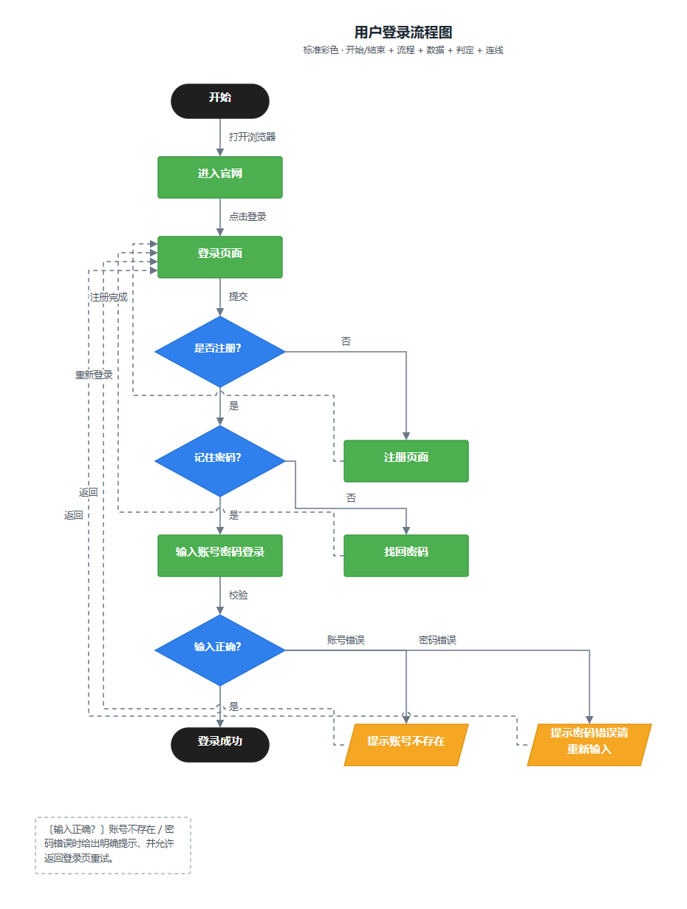
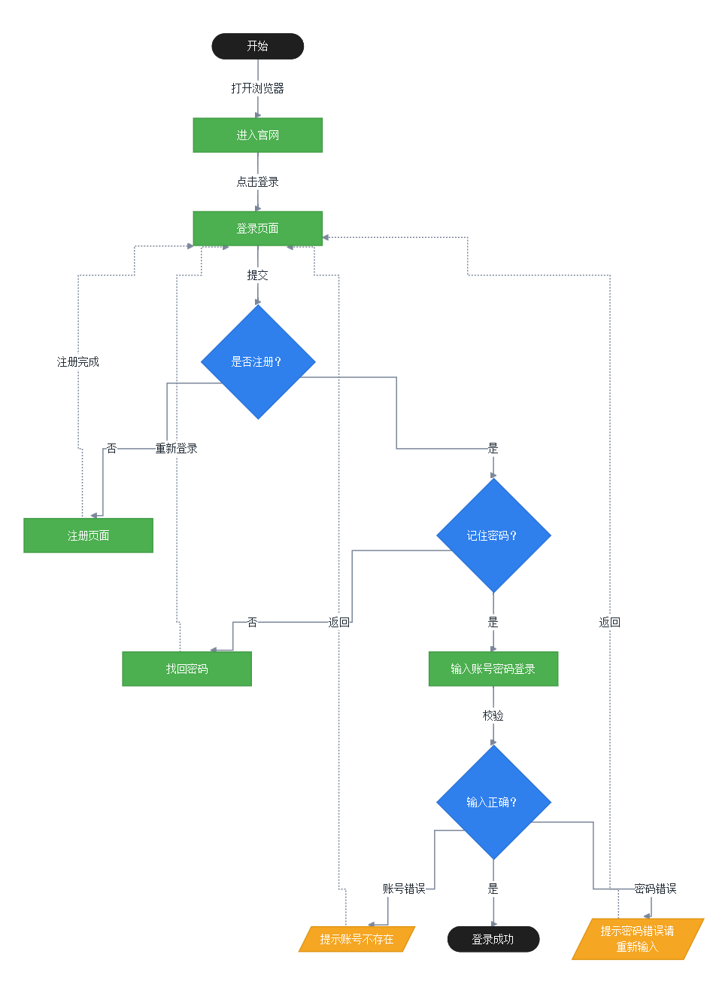
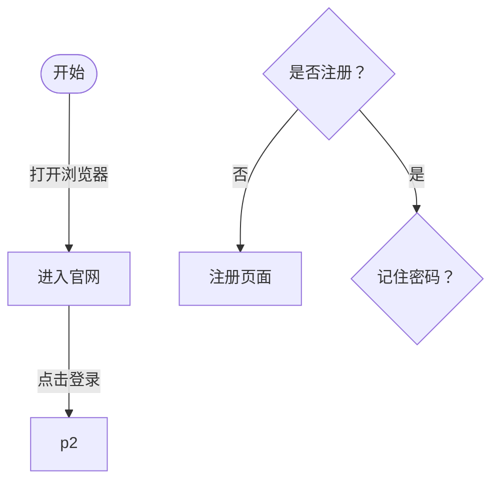

# flowchart-standard

> 按流程图符号标准画业务流程图：**交付 Mermaid 源码 + SVG 矢量图，不出 HTML**。你只描述「有哪些节点、谁连谁、走哪条分支」，脚本负责把图排得横平竖直、分支必标注、不穿框不糊线，并告出不合规之处。



*上图为 `assets/examples/login-standard.json` 的渲染结果：黑色胶囊起止、绿色流程、橙色数据、蓝色判定、灰色带标签连线，四条回流走左侧独立车道。*

同一份 spec 输出的 Mermaid，渲染出来是这样（框等宽、连线正交、标签折行）：



## 五类图形（唯一符号标准）

| # | 图形 | 用途 | 形状 / 颜色 | Mermaid |
|---|---|---|---|---|
| 1 | 开始 / 结束 | 整个流程的起点与终点 | 黑色胶囊 | `s(["开始"])` |
| 2 | 流程 | 描述某一个特定的处理动作 | 绿色矩形 | `p["进入官网"]` |
| 3 | 数据 | 描述某个数据信息（提示/单据/报文） | 橙色平行四边形 | `dt[/"提示账号不存在"/]` |
| 4 | 判定 | 对多走向节点做判定 | 蓝色菱形 | `d{"是否注册？"}` |
| 5 | 连线 | 连接两个流程，并描述动作与判定条件 | 灰色箭头 + 标签 | `-->|"点击登录"|` |

## 为什么同时给 Mermaid 和 SVG

- **Mermaid 是源码**：能复制进任何 Markdown、文档、在线编辑器继续改，是「可编辑的流程图」。
- **SVG 是成品**：Mermaid 的自动布局保证不了流程图规范里的硬要求——同类图形等大、连线正交、分支必标注、回流不叠线、交叉处跨线。这些交给确定性渲染器。

两者图形语义严格一一对应（胶囊/矩形/平行四边形/菱形 + 同色 classDef），改一边不会失真。

### Mermaid 也尽量按标准输出

Mermaid 默认是圆角曲线 + 文字自适应宽度，渲染出来不像流程图。渲染器在源码里固化了这几项：

| 处理 | 效果 |
|---|---|
| `curve: "step"` | 连线走正交折线，不再是斜线/贝塞尔曲线 |
| 标签 `<br/>` 折行 | 长文字按 SVG 同样规则换行，不被拉成横条 |
| 同类型 `min-width` | 流程框等宽、判定框等大、起止胶囊够宽 |
| `rankSpacing` / `nodeSpacing` | 行距列距拉开，框不贴线 |
| `classDef` | 与 SVG 同色同线宽，边标签底色 = 画布色 |

唯一控制不了的是**分支左右**：Mermaid 用 dagre 自动排序，可能把「否」排到左侧。要严格符合「是走下、否走右」，用 SVG。

目标渲染器不支持 `htmlLabels` 时，spec 里加 `"mermaid_html": false`，标签退回纯文本单行。

## 能力

| 维度 | 覆盖 |
|---|---|
| 标准图形 | 胶囊起止、流程矩形、数据平行四边形、判定菱形、子流程、文件、连接符、批注、汇合点 |
| 控制结构 | 顺序、条件（If-Else）、分支（Switch-Case）、循环（While / Do-While） |
| 视觉风格 | `standard` 标准彩色（默认）/ `academic` 学术黑白 / `color` 浅色分类 |
| 交付格式 | **Mermaid 源码 + SVG**（可选 `--html` 预览页，默认不生成） |
| 规范校验 | 25 条规则，E 级阻断交付，W 级提示 |

## 安装

```bash
git clone https://github.com/TJHPiearr23/flowchart-standard.git
cp -r flowchart-standard ~/.workbuddy/skills/
```

Windows 对应目录为 `C:\Users\<用户名>\.workbuddy\skills\flowchart-standard\`。放好后重启 WorkBuddy，在「设置 → 技能 → 已安装」中确认。

技能靠 `description` 自动触发：对话里说「画一张审批流程图」「把这段逻辑画成流程图」即可。

## 快速开始

```bash
python scripts/flowchart.py assets/examples/login-standard.json
```

默认产出 `login-standard.svg` + `login-standard.mmd`，并把 Mermaid 打到终端：



同时打印校验结果：

```
[校验] 节点 12 / 连线 15 / 判定 3 / 错误 0 / 提示 1
```

## 描述文件

最小可用 spec（坐标不用写，布局自动算）：

```json
{
  "title": "用户登录流程",
  "style": "standard",
  "nodes": [
    {"id": "s",  "type": "start",    "text": "开始"},
    {"id": "p1", "type": "process",  "text": "输入账号密码"},
    {"id": "d1", "type": "decision", "text": "密码正确？"},
    {"id": "p2", "type": "process",  "text": "生成令牌"},
    {"id": "dt", "type": "data",     "text": "提示密码错误"},
    {"id": "e",  "type": "end",      "text": "结束"}
  ],
  "edges": [
    {"from": "s",  "to": "p1"},
    {"from": "p1", "to": "d1", "label": "提交"},
    {"from": "d1", "to": "p2", "label": "是"},
    {"from": "d1", "to": "dt", "label": "否"},
    {"from": "p2", "to": "e"},
    {"from": "dt", "to": "p1", "label": "重试", "back": true, "style": "dashed"}
  ]
}
```

字段全表见 [`references/dsl.md`](references/dsl.md)。

## 命令行

```bash
python scripts/flowchart.py spec.json                    # -> spec.svg + spec.mmd，并打印 Mermaid
python scripts/flowchart.py spec.json -o 图.svg --mermaid 图.mmd
python scripts/flowchart.py spec.json --print-only       # 只打印 Mermaid，不落盘
python scripts/flowchart.py spec.json --check            # 只校验不落盘
python scripts/flowchart.py spec.json --check --strict   # 有 E 级问题返回码 1，可做 CI 门禁
python scripts/flowchart.py spec.json --html 图.html      # 可选：额外生成 HTML 预览页
```

## 校验规则（节选）

| 码 | 级别 | 含义 |
|---|---|---|
| E01 | 错误 | 开始节点缺失或多于一个 |
| E05 | 错误 | 节点没有出口，流程中断 |
| E06 | 错误 | 判定少于两条出边 |
| E08 | 错误 | 判定分支未标注 是/否/条件值 |
| E09 | 错误 | 判定出口全是回流 → 死循环 |
| E19 | 错误 | 结束节点有出边 |
| W21 | 提示 | 流程框写成问句，应改用判定 |
| W22 | 提示 | 数据框写成问句 |
| W24 | 提示 | 多出口节点有连线未标注动作 |
| E20 | 提示 | 存在交叉（已画跳线） |

完整 25 条见 [`references/dsl.md`](references/dsl.md#7-校验码表)。

## 目录结构

```
flowchart-standard/
├── SKILL.md                 技能入口：五类图形、交付物、工作流
├── scripts/flowchart.py     渲染器 + 校验器（Mermaid + SVG，零第三方依赖）
├── references/
│   ├── symbols.md           五类图形对照表、易混符号取舍、Mermaid 写法
│   ├── structures.md        四大控制结构画法
│   ├── rules.md             五条图形标准、错误对照、自检清单
│   └── dsl.md               spec 字段全表、布局规则、校验码
└── assets/examples/         6 份可直接改造的样例
```

## 环境

Python 3.8+，无第三方依赖。SVG 内颜色全部内联，单独打开、插 Word/PPT 均正常显示，不依赖 CSS 变量或 JS 运行时。
